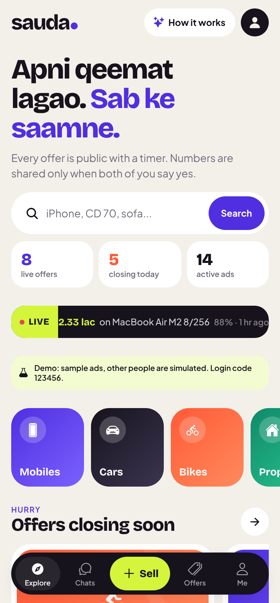
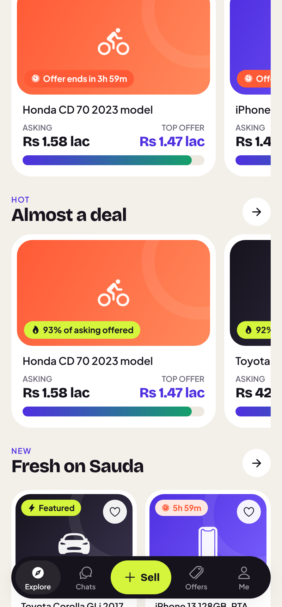
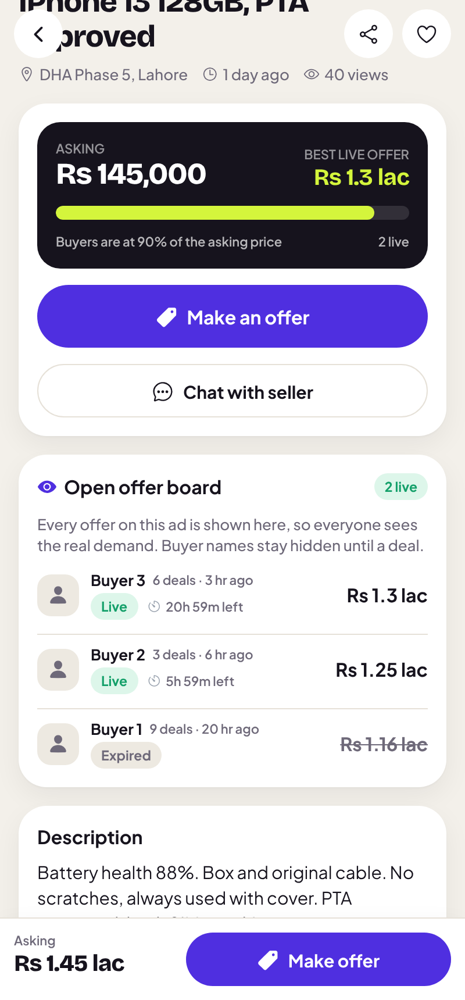
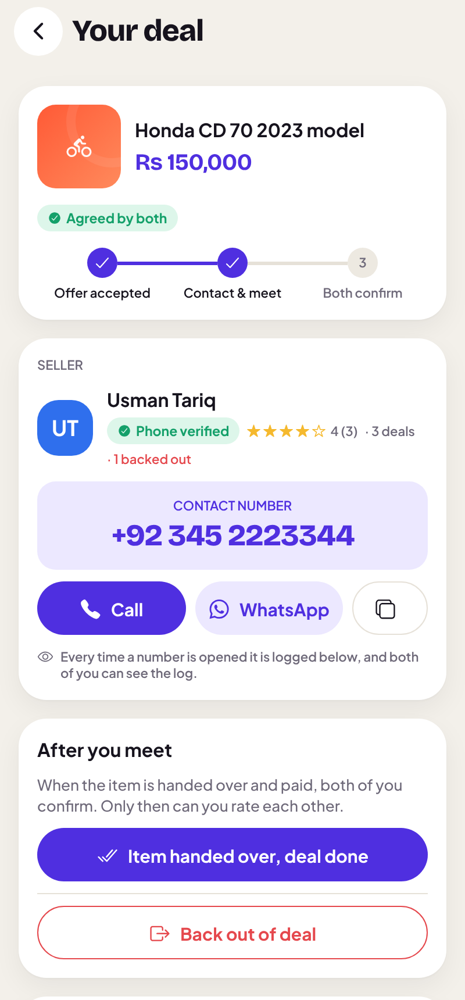

# Sauda: transparent marketplace (Android + web)

Sauda is a buy-and-sell marketplace for Pakistan where **every offer is public and time-limited**, and
**phone numbers are shared only after buyer and seller both agree**.

| Home | Closing soon / almost a deal | Ad + deal meter | Deal (number revealed) |
|---|---|---|---|
|  |  |  |  |

**Design**: "live bazaar" look, not a classic classifieds grid. Violet + lime palette, Bricolage Grotesque headlines,
a live ticker of offers, a deal meter on every card (how close the best offer is to the asking price),
"Offers closing soon" and "Almost a deal" rails, and a floating dock instead of a tab bar.

## What's in this MVP

- **Phone OTP login** (no passwords), name + city profile.
- **Post an ad**: up to 8 photos, category, condition, city/area, price, with a live **price check** against similar ads.
- **Browse & search**: categories, keyword search, city / condition / price filters, sort by newest, price or most offers. Featured ads first.
- **Open offer board** on every ad: amount, status and countdown of every offer are visible to everyone; buyer names are masked ("Buyer 1, 2...").
- **Time-limited offers** (2h, 6h, 12h, 1 day, 2 days). Expired offers close automatically. Offers below 40% of asking are blocked; one open offer per buyer per ad.
- **Seller actions**: accept, decline, or counter. Buyer can accept the counter in one tap.
- **Deals**: accepting creates a deal and reserves the ad. Both sides can then **reveal the other's number** (call / WhatsApp / copy). Every reveal is written to a **reveal log** both can see.
- **Completion & trust**: both confirm hand-over -> deal completed, ad marked sold, deal counts go up. **Ratings only after a completed deal** (one per person per deal). **Backing out** of an agreed deal adds to a public back-out count.
- **Trust profile**: phone verified / ID verified badges, rating, completed deals, back-outs, reviews, active ads, "last seen" (can be hidden).
- **In-app chat** per ad with quick replies; phone numbers typed in chat are blocked so contact goes through the deal flow.
- Saved ads, my ads (pause / resume / mark sold), report ad, share, dark mode, responsive layout for phones and desktop web.

Not built on purpose: the product "pool" / bidding-for-income feature (needs legal review in Pakistan first), payments, and admin panel.

## Tech

- **App**: Expo SDK 58 (React Native + Expo Router), one codebase for Android, iOS and web. TypeScript.
- **Backend**: Supabase (Postgres, phone OTP auth, storage for photos, realtime for chat).
  All trust rules run **inside the database** (`supabase/migrations/`), so a modified app cannot break them:
  row-level security, private phone table, and functions `make_offer`, `respond_offer`, `reveal_phone`,
  `confirm_deal`, `cancel_deal`, `leave_review`, `public_offer_board`.
- **Demo mode**: with no Supabase keys the app runs fully on the device with sample ads and simulated
  buyers/sellers (they reply to offers and chats). Login code in demo mode is `123456`.

## Run it

```bash
npm install
npm run web        # opens in the browser
npm run android    # Android emulator or Expo Go on your phone
npm run typecheck
```

## Connect the real backend (Supabase)

1. Create a free project at supabase.com.
2. SQL editor -> run `supabase/migrations/20261115000000_init.sql`.
3. Authentication -> Providers -> **Phone**: enable it and connect an SMS provider (Twilio, MessageBird, Vonage...).
4. Copy `.env.example` to `.env` and fill `EXPO_PUBLIC_SUPABASE_URL` and `EXPO_PUBLIC_SUPABASE_ANON_KEY`
   (Project Settings -> API).
5. Restart the app. The demo banner disappears and everything is stored in Supabase.

`supabase/tests_scenario.sql` is a walk-through of the rules (low offer blocked, masked board, phone only for deal
parties, rating only after completion, sold ad can't be re-opened) that was run against Postgres 16.

To make an ad "featured" or give someone the "ID verified" badge, set `listings.featured_until` or
`profiles.cnic_verified` from the Supabase dashboard (users can't change these themselves).

## Build for Play Store

```bash
npx eas-cli@latest build -p android --profile production
```
Needs an Expo account and a Google Play developer account.

## Project layout

```
src/app/            screens (Expo Router: tabs, listing/[id], deal/[id], chat/[id], user/[id], login, search...)
src/components/     UI kit, listing cards, offer sheets, price check
src/lib/backend/    Backend interface + demo and Supabase implementations
src/lib/rules.ts    shared offer rules (expiry, minimum offer, price check)
supabase/           database schema, security rules and scenario test
```
